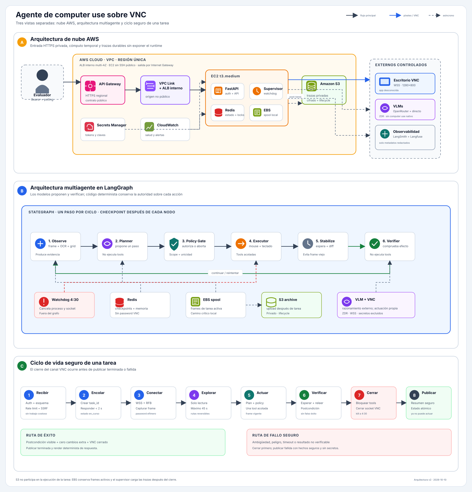

# Documento de diseño — Agente de computer use sobre VNC

**Versión:** 1.1  
**Estado:** arquitectura aprobada; implementación pendiente  
**Audiencia:** ingeniería, evaluación, seguridad y operación  
**Fuente de verdad:** [`frontier-reto-1/README.md`](frontier-reto-1/README.md) y [`frontier-reto-1/pruebas/`](frontier-reto-1/pruebas/)

## 1. Resumen ejecutivo

El sistema recibe tareas en lenguaje natural y opera aplicaciones desconocidas a través de VNC. No usa DOM, API de negocio ni herramientas externas de computer use. Solo observa píxeles y envía eventos de mouse y teclado.

La arquitectura seleccionada es un loop híbrido y verificable:

1. LangGraph controla el ciclo de vida.
2. Un Planner propone un único paso.
3. Un Policy Gate determinista decide si ese paso es seguro.
4. Un Executor envía una primitiva acotada por RFB.
5. Un Verifier independiente comprueba el efecto visible.
6. El sistema cierra VNC antes de publicar el estado final.

La prioridad no es ejecutar la mayor cantidad de acciones. La prioridad es evitar cambios fuera de alcance, duplicados y falsos éxitos.

## 2. Vista visual

La siguiente imagen es un SVG vectorial. Se puede ampliar sin perder calidad y se visualiza directamente desde este Markdown. Reúne las tres vistas arquitectónicas en una sola imagen, pero las mantiene en paneles separados.

La [versión visual anterior](./architecture.svg) se conserva como referencia y no se elimina.

### Cómo leer el diagrama

- **Panel A:** despliegue AWS, red, almacenamiento y sistemas externos.
- **Panel B:** runtime multiagente y responsabilidades de LangGraph.
- **Panel C:** ciclo de vida de una tarea y orden seguro de finalización.
- Dentro de cada panel, el flujo principal avanza de izquierda a derecha.
- Las flechas azules transportan frames o acciones VNC.
- Las flechas discontinuas representan operaciones asíncronas o telemetría.

## 3. Glosario

| Término | Significado |
| --- | --- |
| RFB | Protocolo usado por VNC para framebuffer, teclado y mouse. |
| VNC | Acceso remoto al escritorio que contiene la app legada. |
| Frame | Captura actual del framebuffer 1280×800. |
| Grounding | Conversión de una intención visual en una ubicación concreta de pantalla. |
| Planner | Rol VLM que propone el siguiente paso. |
| Policy Gate | Reglas deterministas que autorizan o rechazan una acción. |
| Executor | Componente que convierte una acción aprobada en eventos RFB. |
| Verifier | Rol VLM que comprueba el efecto de una acción y la postcondición final. |
| Fingerprint | Huella visual usada para distinguir aplicaciones o versiones. |
| ZDR | Zero Data Retention; el proveedor no conserva prompt ni respuesta. |
| Checkpoint | Estado persistido del grafo después de un paso. |

## 4. Objetivos

### 4.1 Objetivos principales

- Operar cualquiera de los sistemas legados sin integración específica.
- Resolver tareas nuevas mediante exploración visual segura.
- Cumplir el contrato HTTP de evaluación.
- Evitar cambios fuera de la tarea.
- Detectar ambigüedad antes de escribir.
- Verificar el resultado antes de declarar éxito.
- Finalizar toda actividad antes de que el escritorio sea reutilizado.
- Mantener secretos fuera de prompts, logs, trazas y resúmenes.

### 4.2 Fuera de alcance

- Usar DOM, selectores CSS, API privada o acceso a la base de datos.
- Usar Anthropic Computer Use, OpenAI CUA/Operator o equivalentes.
- Instalar un MCP que opere la interfaz.
- Entrenar un modelo visual propio.
- Automatizar borrados o cambios masivos.
- Mantener alta disponibilidad multirregión.
- Construir una memoria semántica con datos de negocio.
- Inspeccionar archivos descargados por la aplicación.

## 5. Restricciones no negociables

| Restricción | Impacto arquitectónico |
| --- | --- |
| Solo VNC sobre `wss://.../websockify` | El cliente RFB debe soportar WebSocket seguro. |
| Pantalla 1280×800 | Las coordenadas se normalizan y luego se convierten a píxeles. |
| Repintado de hasta 1 segundo | No se verifica inmediatamente después de una acción. |
| Clic menor de 100 ms se ignora | El Executor usa hold fijo de 150 ms. |
| Escribir concatena texto existente | La escritura en campos usa `Ctrl+A` antes del texto. |
| `POST /tasks` debe responder en menos de 2 segundos | La ejecución corre fuera del request HTTP. |
| Cada tarea dispone de 5 minutos | El watchdog detiene acciones a los 4:30. |
| El escritorio cambia entre tareas | No se confía en memoria sin validar fingerprint. |
| La app puede cambiar durante el día | Toda ruta recordada se revalida visualmente. |
| “Hoy” es la fecha visible en la app | La fecha del servidor no decide fechas relativas. |
| No puede haber acciones después del estado final | Se cierra VNC antes de publicar el resultado. |

## 6. Requerimientos funcionales

| ID | Requerimiento | Criterio de aceptación |
| --- | --- | --- |
| RF-01 | Autenticar todas las rutas públicas con Bearer token. | Una petición sin token válido obtiene 401 y no crea trabajo. |
| RF-02 | Exponer `GET /health`. | Responde 200 solo si API, Redis, supervisor y configuración están listos. |
| RF-03 | Exponer `POST /tasks`. | Devuelve `{"task_id":"..."}` en menos de 2 segundos. |
| RF-04 | Exponer `GET /tasks/{id}`. | Devuelve `en_curso`, `terminada` o `fallida` y un resumen. |
| RF-05 | Usar el escritorio recibido en cada tarea. | No existe una URL VNC fija dentro de la aplicación. |
| RF-06 | Conectar a RFB sobre WSS con contraseña. | El runner obtiene un frame válido de 1280×800. |
| RF-07 | Mantener la contraseña solo en memoria efímera. | Redis, EBS, S3, logs y trazas no contienen la contraseña. |
| RF-08 | Capturar pantalla completa y recortes dirigidos. | El Planner recibe contexto global y detalle cuando lo necesita. |
| RF-09 | Añadir cuadrícula y OCR local como evidencia auxiliar. | Un fallo de OCR no autoriza una acción por sí solo. |
| RF-10 | Detectar estabilidad visual después de cada acción. | Se espera al menos 1 segundo y se comparan frames antes de verificar. |
| RF-11 | Exponer un conjunto acotado de acciones. | No existe una tool de eventos arbitrarios. |
| RF-12 | Mantener cada acción vinculada a un `frame_id`. | Una acción sobre un frame obsoleto se rechaza. |
| RF-13 | Explorar una app desconocida de forma reversible. | La exploración no guarda formularios ni confirma modales. |
| RF-14 | Recordar rutas seguras por fingerprint. | Una ruta solo se reutiliza si la huella coincide y la pantalla se revalida. |
| RF-15 | Buscar duplicados antes de crear. | E1 crea exactamente un registro nuevo. |
| RF-16 | Exigir una coincidencia única antes de actualizar. | E5 falla sin cambiar datos cuando hay homónimos. |
| RF-17 | Consultar sin modificar datos. | E3 produce la respuesta esperada con diff vacío. |
| RF-18 | Recorrer tablas paginadas sin contar filas dos veces. | Las filas se deduplican mediante una huella estable. |
| RF-19 | Exportar solo cuando la tarea lo pide. | E4 usa estado y rango de fechas exactos. |
| RF-20 | Calcular fechas relativas desde la fecha visible. | “Hoy”, “ayer” y días de semana no usan el reloj de EC2. |
| RF-21 | Verificar el efecto de toda acción. | Navegación verifica transición; escritura relee el valor. |
| RF-22 | Verificar la postcondición final. | Un clic en Guardar nunca basta para declarar éxito. |
| RF-23 | Fallar ante ambigüedad o peligro. | El resumen explica los hechos seguros que causaron el fallo. |
| RF-24 | Renderizar el resumen de forma determinista. | Las respuestas siguen exactamente `respuesta: <valor>`. |
| RF-25 | Bloquear tools antes del estado terminal. | Después de `terminada` o `fallida` no se envían eventos RFB. |
| RF-26 | Limitar concurrencia. | Máximo dos tareas globales y una por escritorio. |
| RF-27 | Soportar idempotencia opcional. | La misma key y el mismo body devuelven el mismo `task_id`. |
| RF-28 | Conservar trazas visuales cifradas por 24 horas. | EBS actúa como spool y S3 privado como archivo; las capturas expiran y nunca se sirven públicamente. |
| RF-29 | Registrar trazas redactadas del grafo. | LangSmith recibe metadatos permitidos, no frames ni secretos. |
| RF-30 | Ejecutar evaluaciones reproducibles. | Langfuse compara versiones del agente sobre un dataset versionado. |

## 7. Requerimientos no funcionales

| ID | Categoría | Requerimiento | Objetivo |
| --- | --- | --- | --- |
| RNF-01 | Latencia | Aceptar una tarea rápidamente. | p95 de `POST /tasks` menor de 2 s. |
| RNF-02 | Tiempo | Terminar antes del reset del evaluador. | Cese de acciones a los 4:30. |
| RNF-03 | Seguridad | No exponer credenciales en tránsito. | HTTPS público y WSS hacia el escritorio. |
| RNF-04 | Seguridad | Evitar SSRF mediante la URL VNC. | Solo WSS, DNS/IP pública y bloqueo de rangos especiales. |
| RNF-05 | Seguridad | Aplicar mínimo privilegio. | EC2 sin SSH público; IAM role y Secrets Manager. |
| RNF-06 | Privacidad | Evitar retención por proveedores VLM. | ZDR y `data_collection=deny`. |
| RNF-07 | Integridad | Evitar cambios extra. | Cero acciones destructivas en la suite. |
| RNF-08 | Integridad | Evitar falso éxito. | Cero estados `terminada` sin postcondición. |
| RNF-09 | Confiabilidad | Aislar una tarea bloqueada. | Un proceso separado por tarea. |
| RNF-10 | Confiabilidad | Cancelar aunque el grafo no responda. | Watchdog externo al proceso runner. |
| RNF-11 | Capacidad | Procesar escritorios independientes. | Hasta dos tareas concurrentes si CPU y RAM lo permiten. |
| RNF-12 | Costo | Controlar inferencia visual. | Menos de USD 1 por tarea. |
| RNF-13 | Depurabilidad | Reconstruir cada decisión. | Frame local, acción, efecto esperado y veredicto correlacionados. |
| RNF-14 | Observabilidad | Medir salud operativa. | CPU, RAM, cola, latencia, errores VNC y costo VLM. |
| RNF-15 | Mantenibilidad | Sustituir transporte o modelo. | Interfaces internas para RFB y VLM. |
| RNF-16 | Compatibilidad | Conservar el contrato exacto. | Sin campos obligatorios adicionales. |
| RNF-17 | Disponibilidad | Permanecer accesible durante el demo. | EC2 encendida y health check activo. |
| RNF-18 | Recuperación | No continuar una tarea sin credenciales tras reinicio. | Marcarla fallida y mantener tools cerradas. |
| RNF-19 | Accesibilidad documental | Explicar la arquitectura a perfiles junior. | Diagrama único, glosario y flujo numerado. |
| RNF-20 | Calidad | Superar evaluación repetida. | 5/5 en tres corridas limpias. |
| RNF-21 | Durabilidad | Separar trazas del ciclo de vida de EC2. | Cargar a S3 después de cada tarea sin ponerlo en el camino crítico. |

## 8. Alternativas y tradeoffs

### 8.1 Arquitectura del agente

| Opción | Ventajas | Desventajas | Decisión |
| --- | --- | --- | --- |
| A. VLM monolítico | Menor código y menor latencia inicial. | Grounding frágil; el mismo modelo actúa y certifica; baja depurabilidad. | Rechazada. |
| B. Híbrida jerárquica | Gate determinista, verificación independiente y evidencia rastreable. | Más llamadas VLM y más componentes. | **Seleccionada.** |
| C. Grafo visual completo | Rutas explícitas y buen aprendizaje entre tareas. | Alto costo de construcción; el mapa envejece; no cabe en el plazo. | Rechazada. |

### 8.2 Decisiones de plataforma

| Decisión | Alternativas | Motivo |
| --- | --- | --- |
| LangGraph | Loop propio, Agents SDK, PydanticAI, smolagents | Hace explícitos estados, rutas y checkpoints sin ejecutar computer use por nosotros. |
| Planner + Verifier | Un agente ReAct, enjambre | Evita que quien propone una acción certifique su propio resultado. |
| `py-wsvnc` detrás de interfaz | Adaptar `asyncvnc`, RFB propio | Declara soporte WebSockify; reduce el riesgo del transporte WSS. |
| OCR auxiliar local | Solo VLM, OCR como autoridad, detector set-of-marks | Mejora lectura sin convertir una señal imperfecta en verdad. |
| Redis local | Memoria de proceso, ElastiCache, Postgres | Cruza procesos y mantiene bajo el costo de una demo temporal. |
| OpenRouter con modelo fijado | Routing automático, VLM local | Permite benchmark reproducible y cabe en CPU pequeña. |
| Proveedor directo de fallback | Segunda key OpenRouter | Evita que OpenRouter sea un único dominio de fallo. |
| LangSmith para runtime | Langfuse para todas las trazas | Integración natural con LangGraph y control fino de spans. |
| Langfuse para evals | LangSmith para todo | Datasets versionados y comparación de experimentos. |
| EBS + S3 para screenshots | Solo EBS, solo S3, enviar imágenes a observabilidad | EBS mantiene baja latencia durante la tarea; S3 conserva trazas si EC2 se detiene o reemplaza. |

### 8.3 Entrada pública AWS

| Opción | Costo/Complejidad | Seguridad | Decisión |
| --- | --- | --- | --- |
| HTTP directo a EC2 | Muy baja | Inaceptable: expone token y password. | Rechazada. |
| API Gateway hacia origen público | Baja | El origen sigue siendo atacable. | Rechazada. |
| API Gateway + VPC Link + ALB interno | Media | TLS público y origen privado. | **Seleccionada.** |
| Dominio + Caddy en EC2 | Baja | Correcta, pero requiere dominio administrable. | No disponible. |

### 8.4 Consistencia frente a velocidad

| Política | Beneficio | Costo | Decisión |
| --- | --- | --- | --- |
| Verificar al final | Menos tiempo por paso. | Los errores se acumulan y son difíciles de revertir. | Rechazada. |
| Verificar toda acción por efecto | Detecta errores cerca de su causa. | Aumenta tiempo y llamadas. | **Seleccionada.** |
| Reintentar automáticamente escrituras | Puede superar fallos visuales. | Puede duplicar registros o aplicar dos cambios. | Prohibida. |

### 8.5 Almacenamiento de trazas visuales

| Opción | Ventajas | Desventajas | Decisión |
| --- | --- | --- | --- |
| Solo EBS | Simple, rápido y sin llamadas externas durante la tarea. | Las trazas quedan ligadas a una instancia y volumen concretos. | Rechazada como almacenamiento final. |
| Solo S3 en cada paso | Durable, económico y desacoplado de EC2. | Añade latencia, fallos de red y llamadas en el loop crítico. | Rechazada. |
| EBS como spool + S3 post-tarea | Ejecución local rápida y archivo durable con lifecycle. | Requiere uploader, IAM, cifrado y limpieza en dos lugares. | **Seleccionada.** |
| Observabilidad SaaS con screenshots | Consulta centralizada. | Mayor exposición de datos y dependencia externa. | Prohibida. |

S3 no participa en la decisión ni en la actuación. El runner escribe frames en EBS y el supervisor los carga a S3 únicamente después de cerrar VNC. El bucket:

- Bloquea todo acceso público.
- Usa cifrado del lado del servidor.
- Solo permite acceso al IAM role de EC2.
- Usa prefijos por `task_id` seudónimo.
- No recibe passwords, tokens, headers ni estado crudo de LangGraph.
- Aplica borrado de aplicación a las 24 horas y S3 Lifecycle de un día como respaldo. La expiración de Lifecycle es asíncrona y no garantiza borrado al segundo exacto.

## 9. Arquitectura lógica

### 9.1 Capa de entrada

**Amazon API Gateway**

- Expone una URL HTTPS sin dominio propio.
- Acepta únicamente las rutas del contrato.
- Limita tamaño de request.
- Envía tráfico por VPC Link.

**ALB interno**

- No tiene dirección pública.
- Enruta a FastAPI.
- Usa un endpoint interno de salud.
- Su Security Group es el único origen aceptado por el puerto de la aplicación.

### 9.2 API y supervisor

**FastAPI**

- Autentica antes de parsear trabajo costoso.
- Valida y normaliza la entrada.
- Aplica rate limits por IP y token.
- Escribe estado inicial en Redis.
- Entrega la credencial al supervisor mediante IPC efímero.
- Responde antes de que empiece la interacción VNC.

**Supervisor**

- Mantiene la cola en proceso.
- Adquiere un lock por escritorio.
- Crea un proceso runner.
- Limita ejecución global.
- Mantiene un watchdog fuera del runner.
- Mata el proceso si supera 4:30 o ignora cancelación.

### 9.3 Runtime agéntico

LangGraph orquesta nodos deterministas y llamadas VLM. No entrega control directo del escritorio al modelo.

| Nodo | Tipo | Responsabilidad | Salida |
| --- | --- | --- | --- |
| `initialize` | Determinista | Fijar deadline, presupuestos y contexto seguro. | Estado inicial. |
| `connect_vnc` | I/O | Abrir WSS y autenticar RFB. | Framebuffer listo. |
| `observe` | Determinista | Capturar, estabilizar, aplicar grid, OCR y recortes. | Evidencia con `frame_id`. |
| `fingerprint` | Determinista | Calcular huella de app y recuperar rutas compatibles. | Memoria candidata. |
| `explore` | VLM restringido | Navegar solo por vistas reversibles. | Observación o ruta. |
| `plan` | Planner VLM | Proponer una acción y su efecto esperado. | Propuesta tipada. |
| `policy_gate` | Determinista | Comprobar scope, unicidad, deadline y frame vigente. | Autorizar, observar o abortar. |
| `execute` | Determinista | Convertir la acción a eventos RFB. | Acción emitida. |
| `stabilize` | Determinista | Esperar repintado y estabilidad visual. | Frame posterior. |
| `verify` | Verifier VLM | Comparar antes/después y juzgar postcondición. | Continuar, reintentar, éxito o aborto. |
| `finalize` | Determinista | Cerrar VNC, redactar y publicar estado final. | Resultado terminal. |

### 9.4 Roles multiagénticos

| Rol | Puede observar | Puede proponer | Puede ejecutar | Puede finalizar |
| --- | --- | --- | --- | --- |
| Planner | Sí | Sí, una acción | No | Solo pedir verificación final |
| Verifier | Sí, antes/después | No | No | Emitir veredicto tipado |
| Policy Gate | Metadatos y evidencia | No | Autoriza o rechaza | Puede forzar aborto |
| Executor | Solo acción autorizada | No | Sí | No |
| Watchdog | Tiempo y proceso | No | Solo cancelar/cerrar | Puede forzar fallo |

## 10. Percepción y grounding

### 10.1 Pipeline visual

1. Capturar frame completo.
2. Esperar un mínimo de 1 segundo después de una acción.
3. Capturar frames adicionales hasta detectar estabilidad.
4. Calcular un identificador inmutable del frame.
5. Ejecutar OCR local.
6. Superponer una cuadrícula solo en la copia enviada al VLM.
7. Crear recortes ampliados cuando el Planner no tenga evidencia suficiente.
8. Conservar el frame original para verificación.

### 10.2 Reglas de grounding

- Coordenadas VLM normalizadas entre 0 y 1000.
- Conversión a píxel solo dentro del Executor.
- Rechazo de coordenadas fuera de rango.
- Rechazo si `frame_id` no coincide con el frame vigente.
- Cada acción incluye descripción del objetivo.
- Cada acción incluye efecto esperado.
- El OCR apoya la decisión; no la autoriza.

### 10.3 Scroll y paginación

- Scroll por media página o página completa.
- Solape visual entre capturas.
- Huella para detectar inicio, fin o ciclos.
- Huella de fila para evitar doble conteo.
- Preferencia por filtros visibles antes de recorrer todas las páginas.
- Si existe un total visible, se compara con el conteo extraído.

## 11. Catálogo de acciones

| Acción | Parámetros principales | Guarda obligatoria |
| --- | --- | --- |
| `observe` | región, grid, OCR | No modifica la app. |
| `click` | frame, coordenadas, botón, objetivo, efecto | Hold fijo de 150 ms. |
| `double_click` | frame, coordenadas, objetivo, efecto | Dos clics válidos; usar solo si es necesario. |
| `select_all_type` | frame, coordenadas, texto, efecto | Foco, `Ctrl+A`, escritura y límite de longitud. |
| `key` | frame, tecla permitida, efecto | Allowlist de teclas de navegación. |
| `scroll` | frame, dirección, cantidad, efecto | Sin desplazamientos arbitrarios. |
| `drag` | frame, origen, destino, duración, efecto | Deshabilitada hasta demostrar necesidad. |
| `request_final_verification` | postcondición esperada | No publica el estado por sí misma. |
| `abort` | código y hechos seguros | No acepta secretos en la razón. |

No existen tools de shell, HTTP arbitrario, DOM, clipboard, filesystem de la app ni macros de teclado libres.

## 12. Estado y memoria

### 12.1 Estado persistido por tarea

| Campo | Persistencia | Sensibilidad |
| --- | --- | --- |
| `task_id` | Redis | Baja |
| instrucción | Redis con TTL | Datos de negocio |
| estado externo | Redis | Baja |
| estado interno del grafo | Checkpoint Redis | Media |
| deadline monotónico | Redis/checkpoint | Baja |
| frame actual | Referencia a EBS | Media |
| acción propuesta | Redis/checkpoint | Media |
| veredicto | Redis/checkpoint | Media |
| resumen redactado | Redis | Baja |
| password VNC | Solo memoria del proceso | Secreto |

### 12.2 Memoria entre tareas

Se conserva únicamente:

- Fingerprint de la aplicación.
- Etiquetas estables de navegación.
- Rutas de pantallas previamente verificadas.
- Anclas visuales no sensibles.
- Resultado de éxito o invalidación de una ruta.

No se conserva:

- Clientes, documentos, teléfonos o facturas observadas.
- Password VNC.
- Tokens.
- Screenshots dentro de Redis.
- Respuestas de una tarea para resolver otra.

Langfuse no es memoria operacional. Redis y el Store/checkpointer de LangGraph cumplen esa función.

## 13. Planificación y control

### 13.1 Presupuestos

| Recurso | Límite inicial |
| --- | --- |
| Exploración | 45 segundos |
| Acciones | 40 |
| Reintentos transitorios por operación | 2 |
| Reintentos de escritura | 0 sin relectura |
| Tareas simultáneas | 2 globales |
| Tareas por escritorio | 1 |
| Cese de acciones | 4:30 |
| Límite del evaluador | 5:00 |
| Costo VLM | USD 1 por tarea |

### 13.2 Condiciones previas a una escritura

Una escritura se autoriza únicamente cuando:

1. El objetivo es único.
2. El valor actual fue observado.
3. El cambio coincide exactamente con la tarea.
4. No existe evidencia de ambigüedad.
5. El `frame_id` sigue vigente.
6. Queda tiempo suficiente para verificar.
7. La acción no está prohibida.

### 13.3 Política de reintentos

- Red y modelo: reintento con backoff dentro del presupuesto.
- Lectura visual: nueva observación o recorte.
- Navegación fallida: una nueva planificación.
- Escritura con resultado incierto: releer; nunca repetir a ciegas.
- Creación con resultado incierto: buscar el registro antes de considerar otro intento.

## 14. Verificación y resumen

### 14.1 Evidencia de éxito

| Tipo de tarea | Evidencia requerida |
| --- | --- |
| Crear | Registro visible con campos clave y búsqueda posterior sin duplicado. |
| Actualizar | Registro único y nuevo valor releído. |
| Consultar | Conteo o dato extraído sin cambios en la app. |
| Exportar | Filtros visibles correctos y señal visual de exportación. |
| Rechazar | Evidencia de ambigüedad o peligro y ausencia de cambios. |

### 14.2 Estado terminal

El orden de finalización es obligatorio:

1. Congelar el grafo.
2. Revocar capacidad de ejecutar tools.
3. Cerrar la conexión VNC.
4. Detener tareas auxiliares.
5. Generar el resumen determinista.
6. Redactar secretos.
7. Escribir estado y resumen en Redis de forma atómica.

### 14.3 Formato del resumen

- Pregunta con un dato: `respuesta: <valor>`.
- Pregunta con dos datos: `respuesta: <dato 1>; <dato 2>`.
- Si es número, aparece antes de cualquier otro número en esa línea.
- Una pregunta no respondible no incluye línea `respuesta:`.
- Un fallo nombra hechos distintivos seguros.
- El renderer usa campos permitidos; no copia texto arbitrario del prompt.

## 15. API y seguridad de entrada

### 15.1 `GET /health`

- Requiere Bearer.
- Comprueba Redis, supervisor y configuración.
- No ejecuta una inferencia real.
- Devuelve 200 cuando el agente puede aceptar o encolar trabajo.

### 15.2 `POST /tasks`

- Rechaza campos inesperados.
- `tarea`: texto no vacío, máximo 4.000 caracteres.
- `escritorio.url`: esquema WSS, host público y sin userinfo.
- `escritorio.password`: entre 1 y 256 caracteres.
- Resuelve DNS y bloquea loopback, link-local, RFC1918 y metadata de AWS.
- No registra el body completo.
- Devuelve únicamente `task_id`.

### 15.3 `GET /tasks/{id}`

- Requiere Bearer.
- Valida el formato de ID.
- No revela si un ID pertenece a otro token.
- Devuelve solo estado y resumen.

### 15.4 Rate limiting inicial

| Endpoint | Por IP | Por token |
| --- | --- | --- |
| `POST /tasks` | 5 por minuto | 5 por minuto |
| `GET /tasks/{id}` | 120 por minuto | 120 por minuto |
| `GET /health` | 30 por minuto | 30 por minuto |

Una respuesta 429 incluye `Retry-After` y no crea trabajo.

## 16. Seguridad operacional

### 16.1 Acciones prohibidas

- Borrar, archivar o cancelar registros.
- Ejecutar cambios masivos.
- Elegir un homónimo por probabilidad.
- Crear sin dedupe.
- Guardar un formulario fuera de alcance.
- Confirmar un modal destructivo no previsto.
- Exportar sin petición explícita.
- Navegar fuera de la aplicación.
- Repetir una escritura no idempotente a ciegas.
- Actuar después de 4:30.
- Actuar después del cierre VNC.
- Enviar secretos al VLM o a observabilidad.

### 16.2 Amenazas y mitigaciones

| Amenaza | Mitigación |
| --- | --- |
| Robo del Bearer token | TLS, Secrets Manager, logs redactados y comparación constante. |
| SSRF mediante URL VNC | WSS obligatorio, resolución segura y bloqueo de rangos internos. |
| Prompt injection visible en la app | El texto de pantalla es evidencia, no instrucción; el system prompt tiene precedencia. |
| Click en coordenada incorrecta | Grid, `frame_id`, objetivo descrito y verificación posterior. |
| Doble creación | Dedupe previo y búsqueda posterior si el resultado es incierto. |
| Actualización del homónimo incorrecto | Coincidencia exactamente única o fallo. |
| Acción después del timeout | Watchdog externo, kill del proceso y cierre de socket. |
| Secreto en resumen | Renderer por allowlist y scrubber final. |
| Secreto en trazas SaaS | Spans construidos por allowlist; sin estado crudo ni imágenes. |
| Acceso a screenshots | EBS y S3 cifrados, Block Public Access, IAM mínimo y borrado a las 24 horas. |

## 17. Observabilidad

### 17.1 LangSmith

Registra:

- `task_id` seudónimo.
- Nombre del nodo.
- Duración.
- Número de acción.
- Tipo de acción.
- Veredicto.
- Tokens y costo.
- Código de error.

No registra:

- Screenshot.
- Password VNC.
- Bearer token.
- Headers.
- Estado completo de LangGraph.
- Texto de campos sensibles.

### 17.2 Langfuse

Se usa para:

- Dataset versionado E1–E5.
- Variante visual oculta.
- Experimentos por modelo y prompt.
- Scores deterministas.
- Comparación de costo, latencia y éxito.

No se usa para:

- Memoria del agente.
- Checkpoints.
- Credenciales.
- Screenshots de producción.

### 17.3 CloudWatch

- Salud de la instancia.
- CPU, RAM y disco.
- Tamaño de cola.
- Procesos activos.
- Errores del supervisor.
- Alarmas por falta de capacidad o disco.

### 17.4 Trazas visuales en EBS y S3

Durante una tarea, los frames permanecen en un directorio privado de EBS. Después de cerrar VNC:

1. El supervisor elimina cualquier secreto residual de metadatos.
2. Empaqueta el manifiesto de acciones, hashes y screenshots.
3. Carga el paquete al prefijo privado de la tarea en S3.
4. Verifica que S3 confirmó la escritura.
5. Elimina el spool local cuando ya no es necesario.

Si S3 no está disponible, la tarea conserva su resultado. El upload se reintenta fuera del proceso runner y nunca cambia `terminada` por `fallida`.

## 18. Despliegue

### 18.1 Recursos

| Recurso | Configuración |
| --- | --- |
| API Gateway | HTTP API regional con URL `execute-api`. |
| VPC Link | Acceso privado al ALB. |
| ALB | Interno, health check privado y presencia en dos subredes/AZ. |
| EC2 | `t3.medium`, una sola instancia. |
| EBS | Cifrado; spool local para frames de tareas activas. |
| S3 | Bucket privado, cifrado, Block Public Access y lifecycle de un día. |
| Redis | Local, loopback, contraseña y sin puerto público. |
| Secrets Manager | Tokens y claves de proveedor. |
| IAM | Role de mínimo privilegio para EC2. |
| SSM | Administración sin abrir SSH. |
| CloudWatch | Métricas, logs redactados y alarmas. |

### 18.2 Flujo de red

- Entrada pública: evaluador → API Gateway por HTTPS.
- Entrada privada: API Gateway → VPC Link → ALB → FastAPI.
- Salida: EC2 → escritorio por WSS.
- Salida: EC2 → OpenRouter y fallback por HTTPS.
- Salida: EC2 → LangSmith y Langfuse con datos permitidos.
- Salida asíncrona: EC2 → S3 por HTTPS después de cerrar VNC.
- No existe entrada directa desde internet a FastAPI, Redis, EBS o S3.

### 18.3 Escalamiento

La arquitectura no escala horizontalmente durante la demo. Una segunda instancia rompería la cola en proceso y el Redis local.

Si se necesitara escalar después:

1. Mover cola a SQS.
2. Mover Redis a ElastiCache.
3. Ejecutar runners en ECS.
4. Separar el uploader de trazas en un worker.
5. Mantener lock distribuido por escritorio.

Eso queda fuera del MVP.

## 19. Plan de evaluación

### 19.1 Harness

1. Ejecutar `POST /__reset`.
2. Esperar pantalla estable.
3. Enviar `POST /tasks`.
4. Consultar estado cada 5 segundos.
5. Validar estado y resumen.
6. Ejecutar `POST /__check`.
7. Confirmar que el proceso terminó y el socket VNC está cerrado.
8. Repetir tres veces con orden aleatorio.

### 19.2 Cobertura

| Caso | Capacidad evaluada | Condición crítica |
| --- | --- | --- |
| E1 | Creación | Dedupe y exactamente un registro. |
| E2 | Actualización | Objetivo único y reemplazo, no concatenación. |
| E3 | Consulta | Cero cambios y `respuesta: 45`. |
| E4 | Exportación | Estado y rango exactos. |
| E5 | Rechazo | Cero cambios, `fallida` y dos documentos. |

### 19.3 Métricas

- Tasa de éxito completa.
- Falsos éxitos.
- Acciones fuera de alcance.
- Registros duplicados.
- p50 y p95 de duración.
- Costo VLM por tarea.
- Número de acciones.
- Reintentos.
- Errores de grounding.
- Operaciones posteriores al estado terminal.

### 19.4 Criterio de salida

- 5/5 en tres corridas.
- Cero cambios extra.
- Cero duplicados.
- Cero falsos éxitos.
- p95 menor de 4:30.
- Costo menor de USD 1 por tarea.
- Ninguna acción posterior al cierre.

## 20. Fallos esperados

| Fallo | Comportamiento |
| --- | --- |
| No conecta a VNC | Reintentar dentro del presupuesto; luego `fallida`. |
| Auth VNC inválida | `fallida` sin reenviar password a logs. |
| Frame no cambia | Reobservar; no repetir escritura automáticamente. |
| Popup desconocido | Clasificar; si no coincide con el plan, abortar. |
| OCR y VLM discrepan | Pedir recorte o reobservación. |
| Dos objetivos coinciden | `fallida` con identificadores seguros. |
| Proveedor VLM cae | Usar fallback directo; si falla, cerrar y reportar fallo. |
| Redis cae | No aceptar nuevas tareas; runners cierran de forma segura. |
| Runner se bloquea | Watchdog mata proceso y cierra socket. |
| Disco se acerca al límite | Borrar trazas expiradas; conservar logs mínimos. |
| Reinicio de EC2 | Tareas sin credencial efímera pasan a `fallida`. |

## 21. Supuestos y riesgos abiertos

| ID | Tipo | Descripción | Tratamiento |
| --- | --- | --- | --- |
| S-01 | SUPUESTO | `py-wsvnc` soporta el auth y encoding exactos del reto. | Spike obligatorio antes del resto. |
| S-02 | SUPUESTO | El modelo elegido acepta visión y salida estructurada con ZDR. | Benchmark de 2–3 modelos. |
| S-03 | SUPUESTO | Habrá una key directa para fallback. | Si no llega, fallar cerrado ante caída. |
| S-04 | SUPUESTO | API Gateway, VPC Link y ALB se pueden aprovisionar hoy. | Crear infraestructura temprano. |
| S-05 | SUPUESTO | La URL VNC resuelve a IP pública desde EC2. | Validar con el escritorio de práctica. |
| R-01 | RIESGO | Dos runners saturan 4 GB de RAM. | Reducir concurrencia a uno sobre 80%. |
| R-02 | RIESGO | OCR agrega latencia sin mejorar grounding. | Mantenerlo auxiliar y recortable. |
| R-03 | RIESGO | ALB/VPC Link consumen tiempo de configuración. | Smoke test temprano; no esperar al final. |
| R-04 | RIESGO | LangSmith y Langfuse duplican telemetría. | Runtime solo en LangSmith; evals en Langfuse. |
| R-05 | RIESGO | Memoria obsoleta induce rutas incorrectas. | Fingerprint, TTL y revalidación. |

## 22. Recortes permitidos

Si el tiempo no alcanza, recortar en este orden:

1. Memoria entre tareas.
2. OCR avanzado; conservar frame completo y grid.
3. Recortes adaptativos.
4. Fallback directo; fallar cerrado.
5. Screenshots de tareas exitosas; conservar los fallos.

Nunca recortar:

- Auth.
- Validación.
- Protección SSRF.
- Dedupe.
- Policy Gate.
- Verifier.
- Watchdog.
- Cierre VNC.
- Redacción de secretos.
- Pruebas E1–E5.

## 23. Decisiones pendientes de benchmark

Estas decisiones no cambian la arquitectura:

- Modelo VLM principal.
- Modelo/proveedor directo de fallback.
- Umbral de estabilidad visual.
- OCR local concreto y paquetes de idioma.
- Concurrencia real de uno o dos runners.
- Número máximo de acciones por tipo de tarea.

## 24. Fuentes

### Fuentes del reto

- [`frontier-reto-1/README.md`](frontier-reto-1/README.md)
- [`frontier-reto-1/pruebas/E1-crear-cliente.json`](frontier-reto-1/pruebas/E1-crear-cliente.json)
- [`frontier-reto-1/pruebas/E2-direccion-con-nota.json`](frontier-reto-1/pruebas/E2-direccion-con-nota.json)
- [`frontier-reto-1/pruebas/E3-facturas-vencidas.json`](frontier-reto-1/pruebas/E3-facturas-vencidas.json)
- [`frontier-reto-1/pruebas/E4-exportar-pedidos.json`](frontier-reto-1/pruebas/E4-exportar-pedidos.json)
- [`frontier-reto-1/pruebas/E5-homonimos.json`](frontier-reto-1/pruebas/E5-homonimos.json)

### Fuentes técnicas

- [LangGraph: memoria y Redis checkpointer](https://docs.langchain.com/oss/python/langgraph/add-memory)
- [LangSmith: cliente y anonimización](https://docs.smith.langchain.com/reference/python/client/langsmith.client.Client)
- [Langfuse: evaluación offline](https://langfuse.com/docs/evaluation/get-started/offline)
- [OpenRouter: Zero Data Retention](https://openrouter.ai/docs/guides/features/zdr)
- [OpenRouter: provider routing](https://openrouter.ai/docs/guides/routing/provider-selection)
- [AsyncVNC](https://asyncvnc.readthedocs.io/en/latest/index.html)
- [py-wsvnc](https://github.com/Cynnovative/py-wsvnc)

